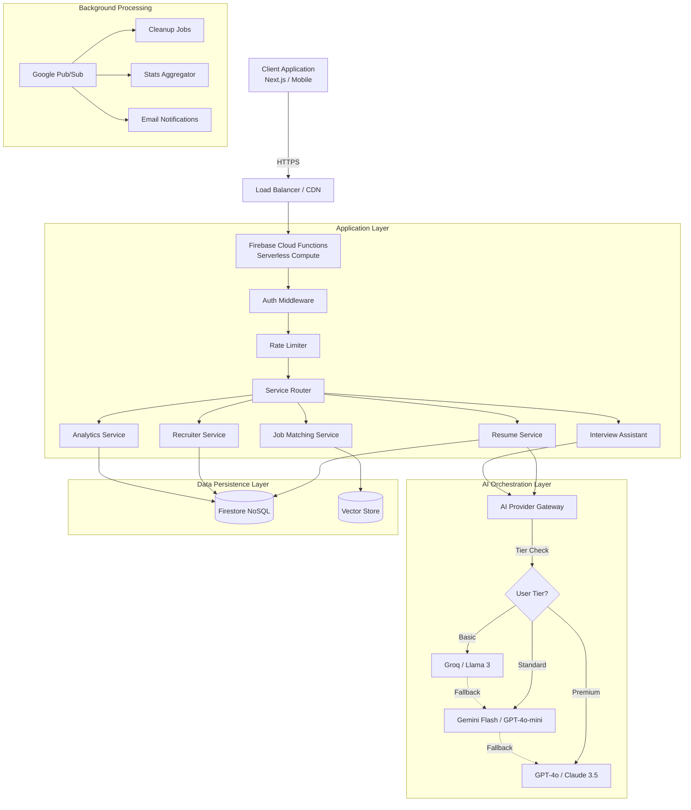

# System Architecture & Design Decisions

## 1. High-Level Architecture Diagram



```text
┌─────────────────────────────────────────────────────────────────────────────┐
│                           CLIENT APPLICATION                                 │
│               (Next.js 14 App Router / React Server Components)              │
└────────────────────────────────┬────────────────────────────────────────────┘
                                 │
                                 │ HTTPS / REST
                                 │
┌────────────────────────────────▼────────────────────────────────────────────┐
│                      FIREBASE CLOUD FUNCTIONS                                │
│                   (Node.js 20 Runtime - Serverless)                          │
│                                                                              │
│  ┌──────────────────────────────────────────────────────────────────────┐  │
│  │                    REQUEST PROCESSING PIPELINE                        │  │
│  │                                                                       │  │
│  │  1. Auth Check ──► 2. Rate Limit ──► 3. Validation ──► 4. Routing     │  │
│  │     (JWT Verify)    (Redis/Firestore)    (Zod Schemas)                │  │
│  └──────────────────────────────────────────────────────────────────────┘  │
│                                                                              │
│  ┌─────────────────────────────────────────────────────────────────────┐   │
│  │                       DOMAIN SERVICES                                │   │
│  │                                                                      │   │
│  │  ┌──────────────┐  ┌──────────────┐  ┌──────────────┐             │   │
│  │  │   Resume     │  │  Recruiter   │  │  Interview   │             │   │
│  │  │   Core       │  │   Pipeline   │  │  Assistant   │             │   │
│  │  └──────┬───────┘  └──────┬───────┘  └──────┬───────┘             │   │
│  │         │                 │                 │                      │   │
│  │         └─────────────────┼─────────────────┘                      │   │
│  │                           │                                        │   │
│  │                  ┌────────▼────────┐                               │   │
│  │                  │   AI Gateway    │                               │   │
│  │                  │ (Tier Routing)  │                               │   │
│  │                  └────────┬────────┘                               │   │
│  └───────────────────────────┼────────────────────────────────────────┘   │
│                              │                                            │
│  ┌───────────────────────────▼────────────────────────────────────────┐   │
│  │                  EXTERNAL AI PROVIDERS                             │   │
│  │               (Managed via Circuit Breaker)                        │   │
│  │                                                                    │   │
│  │  ┌──────────┐    ┌──────────┐    ┌──────────┐    ┌──────────┐      │   │
│  │  │   Groq   │    │  Google  │    │  OpenAI  │    │ Anthropic│      │   │
│  │  │ (Llama3) │    │ (Gemini) │    │ (GPT-4o) │    │ (Claude) │      │   │
│  │  └────┬─────┘    └────┬─────┘    └────┬─────┘    └────┬─────┘      │   │
│  │       │   Fallback    │   Fallback    │               │            │   │
│  │       └───────►───────┴───────►───────┴───────►───────┘            │   │
│  └────────────────────────────────────────────────────────────────────┘   │
│                                                                           │
└──────────────┬──────────────────────────────┬─────────────────────────────┘
               │                              │
               │ Reads/Writes                 │ Vector Embeddings
               │                              │
┌──────────────▼──────────────┐      ┌────────▼─────────────────────────────┐
│     FIRESTORE (NoSQL)       │      │      VECTOR SEARCH (Hybrid)          │
│                             │      │                                      │
│  • Users / Profiles         │      │  • Resume Embeddings                 │
│  • Recruiter Pipelines      │      │  • Job Description Embeddings        │
│  • Analytics Events         │      │  • Semantic Similarity Search        │
│  • Rate Limit Counters      │      │                                      │
└─────────────────────────────┘      └──────────────────────────────────────┘
```

---

## 2. Component Deep Dive & Design Decisions (Interview Guide)

This section explains **why** we chose specific technologies and patterns, and **why not** alternatives. This is crucial for understanding the system's trade-offs.

### A. Frontend: Next.js 14 (App Router)

- **Why This:**
  - **Server-Side Rendering (SSR):** Critical for SEO (Search Engine Optimization). Resume profiles need to be indexable by Google/Bing.
  - **React Server Components (RSC):** Reduces the JavaScript bundle size sent to the client. We render heavy UI on the server and only send HTML, making the app load faster on mobile devices.
  - **Vercel Integration:** Seamless deployment and edge caching.
- **Why Not Create React App (CRA) / Vite (SPA):**
  - Single Page Applications (SPAs) struggle with SEO.
  - Initial load time is slower because the browser has to download all JS before rendering anything.

### B. Backend: Firebase Cloud Functions (Serverless)

- **Why This:**
  - **Scale-to-Zero:** We pay $0 when no one is using the app. Perfect for a startup or variable traffic.
  - **Event-Driven:** We can trigger functions automatically when a user signs up (`auth.user().onCreate`) or when a database record changes. This decouples our logic.
  - **Maintenance:** No servers to patch, upgrade, or restart. Google manages the infrastructure.
- **Why Not EC2 / Docker / Kubernetes:**
  - **Overhead:** Requires managing OS updates, scaling groups, and load balancers.
  - **Cost:** You pay for idle time (servers running 24/7 even if no users are online).
  - **Complexity:** Kubernetes is overkill for our current scale and team size.

### C. Database: Firestore (NoSQL)

- **Why This:**
  - **Flexible Schema:** Resume structures change often (adding new sections like "Projects" or "Certifications"). NoSQL allows us to adapt without running complex SQL migrations.
  - **Real-time:** Firestore pushes updates to the client instantly. If a recruiter views a profile, the user gets a notification immediately without refreshing.
  - **Integration:** Tightly coupled with Firebase Auth and Security Rules, saving us months of security boilerplate code.
- **Why Not PostgreSQL / MySQL:**
  - **Rigid Schema:** Changing the database structure requires downtime or complex migration scripts.
  - **Connection Management:** SQL databases struggle with thousands of concurrent serverless connections (the "thundering herd" problem). Firestore handles this natively.

### D. AI Orchestration: The "Tiered Gateway" Pattern

- **Why This:**
  - **Cost Optimization:** We don't want to pay for GPT-4o (expensive) for a free user. We route them to Groq/Llama-3 (cheap/free).
  - **Reliability:** If OpenAI goes down, our system automatically falls back to Anthropic or Gemini. The user never sees an error.
  - **Performance:** Groq is incredibly fast (low latency), making the UI feel snappy for simple tasks.
- **Why Not Just One Provider (e.g., Only OpenAI):**
  - **Vendor Lock-in:** If they raise prices or change policies, we are stuck.
  - **Single Point of Failure:** If they have an outage, our entire app stops working.

### E. Search: Vector Search (Embeddings)

- **Why This:**
  - **Semantic Understanding:** A keyword search for "Software Engineer" might miss a resume that says "React Developer". Vector search understands that these concepts are related.
  - **Matching Quality:** We convert resumes and job descriptions into mathematical vectors (arrays of numbers). The "distance" between them represents how good the match is.
- **Why Not Simple Text Search (Algolia / Elasticsearch):**
  - **Keyword Limitation:** They rely heavily on exact word matches.
  - **Cost:** Dedicated search engines can be expensive to host and maintain.

### F. System Configuration & Maintenance Controls

- **Why This:**
  - **Instant Toggles:** Operational flags (registration/login disable, maintenance banner, feature nudges) live in `config/system` on Firestore, so we can flip them from the Firebase Console without redeploying.
  - **Global Visibility:** `SystemConfigProvider` reads the document once per session (with sessionStorage caching) and exposes it to components; the `MaintenanceBanner` reacts in milliseconds when the doc changes.
  - **Safe Defaults:** If Firestore is unreachable, the app falls back to "all features on" to avoid locking out users due to transient errors.
- **Operational Details:**
  - Config document shape: `{ maintenance: { isActive, blocking, message }, auth: { registrationClosed, loginDisabled }, features: { enableAnalytics, enableMockData } }`.
  - CLI helper: `node scripts/toggle-maintenance.js on "Message" [--blocking]` updates the doc for staging/production smoke tests.
- **Why Not Env Vars:**
  - Environment variables required a full redeploy and forced cold starts; multiple regions could drift. Firestore updates are atomic and auditable, and the plan keeps us within the free read quota (one cached read per session).

---

## 3. Key Architecture Patterns

### 1. Circuit Breaker Pattern

- **What:** Like a fuse in your house. If an external service (e.g., OpenAI) fails repeatedly, we "trip" the breaker and stop calling it for a while.
- **Why:** Prevents our system from hanging or crashing while waiting for a dead service. It allows the system to fail fast and recover.

### 2. Strategy Pattern (AI Providers)

- **What:** We define a common interface (`generateText`) and have multiple implementations (`OpenAIProvider`, `GeminiProvider`).
- **Why:** We can swap AI models at runtime without changing the business logic code.

### 3. Pub/Sub (Publisher/Subscriber)

- **What:** Asynchronous messaging. When a user uploads a resume, we publish a `resume_uploaded` event.
- **Why:** The "upload" function finishes quickly. Background workers pick up the event to do the heavy lifting (parsing, AI analysis, thumbnail generation) without making the user wait.

---

## 4. Data Flow Example: "Generate AI Resume"

1.  **Request:** User clicks "Enhance Resume".
2.  **Middleware:**
    - Checks **Auth Token** (Is this a valid user?).
    - Checks **Rate Limit** (Has this user made >10 requests this hour?).
3.  **Service Layer (AI Gateway):**
    - **Check User Tier:**
      - _Free User:_ Route to **Groq** (Llama 3.1).
      - _Premium User:_ Route to **OpenAI** (GPT-4o).
    - **Execution:**
      - Try Primary Provider.
      - _If Fail:_ Retry with Exponential Backoff.
      - _If Still Fail:_ Switch to Fallback Provider (e.g., Gemini).
4.  **Response:**
    - Stream result back to client.
    - Save usage stats to Firestore (for billing/analytics).

---

## 5. System Components Reference

### A. Cloud Functions (Serverless Backend)

| Function Name                   | Trigger Type        | Description                                                               |
| :------------------------------ | :------------------ | :------------------------------------------------------------------------ |
| **Core Business Logic**         |                     |                                                                           |
| `generateResumeContent`         | Callable (HTTPS)    | Uses AI to enhance resume content based on user input and selected tier.  |
| `generateJobMatchSuggestions`   | Callable (HTTPS)    | Analyzes resume vs. job description to suggest improvements.              |
| `searchResumesAI`               | Callable (HTTPS)    | Performs semantic vector search to find resumes matching a query.         |
| **Background Jobs (Scheduled)** |                     |                                                                           |
| `aggregateGlobalStats`          | Scheduled (Hourly)  | Aggregates system-wide stats (total users, resumes) for the landing page. |
| `aggregateAnalyticsDaily`       | Scheduled (Daily)   | Compresses raw analytics events into daily summaries to save storage.     |
| `cleanupAnalyticsEvents`        | Scheduled (Weekly)  | Deletes raw analytics events older than 30 days (GDPR/Cost).              |
| `cleanupExpiredResumes`         | Scheduled (Daily)   | Removes resumes marked for deletion or expired drafts.                    |
| `cleanupRecruiterSearchHistory` | Scheduled (Monthly) | Anonymizes or deletes old recruiter search logs.                          |
| `cleanupRateLimits`             | Scheduled (Hourly)  | Resets distributed rate limit counters in Firestore.                      |
| `cleanupAuditLogs`              | Scheduled (Daily)   | Archives old audit logs to cold storage (if configured) or deletes them.  |
| `sendProfileViewDigest`         | Scheduled (Weekly)  | Sends email summary to users about who viewed their profile.              |
| **Event Triggers (Reactive)**   |                     |                                                                           |
| `onUserCreated`                 | Auth.onCreate       | Initializes user profile, sets default roles, and sends welcome email.    |
| `onUserRoleChanged`             | Auth.onUpdate       | Syncs custom claims (admin/recruiter) when Firestore role changes.        |
| `onRecruiterRequestCreated`     | Firestore.onCreate  | Notifies candidate when a recruiter requests access.                      |
| `onRecruiterRequestApproved`    | Firestore.onUpdate  | Grants access permissions when a request is approved.                     |
| `notifyAdminSuspiciousActivity` | Firestore.onCreate  | Alerts admins if high-velocity actions are detected.                      |
| `indexResumeOnWrite`            | Firestore.onWrite   | Updates the Vector Search index whenever a resume is saved.               |
| `reindexResume`                 | Callable (Admin)    | Manually triggers re-indexing for a specific resume.                      |

### B. Firestore Indexes (Performance Optimization)

| Collection               | Fields Indexed                            | Purpose                                                          |
| :----------------------- | :---------------------------------------- | :--------------------------------------------------------------- |
| `accessRequests`         | `fromUserId` (ASC), `timestamp` (DESC)    | Efficiently list requests sent by a specific user, newest first. |
| `recruiterSearchHistory` | `recruiterId` (ASC), `createdAt` (DESC)   | Show search history for a recruiter dashboard.                   |
| `events`                 | `timestamp` (ASC), `eventType` (ASC)      | Time-series analysis of system events.                           |
| `auditLogs`              | `userId` (ASC), `timestamp` (DESC)        | Security audit trail for a specific user.                        |
| `resumes`                | `isBeingEdited` (ASC), `updatedAt` (DESC) | List recently updated public resumes (excludes drafts).          |
| `resumes`                | `isBeingEdited`, `embedding`, `updatedAt` | **Composite Index** for Vector Search filtering.                 |
| `drafts`                 | `userId` (ASC), `createdAt` (DESC)        | Show a user's draft resumes.                                     |

### C. Key Domain Services (`src/lib/services`)

| Service Name        | Responsibility                                               | Key Design Pattern                                                |
| :------------------ | :----------------------------------------------------------- | :---------------------------------------------------------------- |
| `AIProviderService` | Manages connections to OpenAI, Gemini, Groq, etc.            | **Strategy Pattern** (swappable providers) + **Circuit Breaker**. |
| `ResumeService`     | CRUD operations for resumes, versioning, and PDF generation. | **Repository Pattern** (abstracts Firestore).                     |
| `JobMatchService`   | Calculates compatibility scores between resumes and jobs.    | **Vector Similarity** (Cosine Similarity).                        |
| `RecruiterService`  | Handles recruiter workflows (search, pipelines, requests).   | **Role-Based Access Control (RBAC)**.                             |
| `AnalyticsService`  | Tracks user behavior (views, clicks) without blocking UI.    | **Fire-and-Forget** (async logging).                              |
| `InterviewSession`  | Manages state for AI mock interviews.                        | **State Machine** (Idle -> Asking -> Listening -> Feedback).      |

### D. Security Rules (`firestore.rules`) Highlights

1.  **User Isolation:** `match /users/{userId}` rules ensure users can only read/write their own data.
2.  **Role-Based Access:** `request.auth.token.role == 'recruiter'` checks Custom Claims to grant special access to resume search.
3.  **Immutable Fields:** Rules prevent users from modifying sensitive fields like `isVerified` or `subscriptionStatus` directly (must be done via Admin SDK).
4.  **Rate Limiting Support:** `request.time` checks in rules can prevent rapid-fire writes (though we primarily use Redis/Firestore counters).
