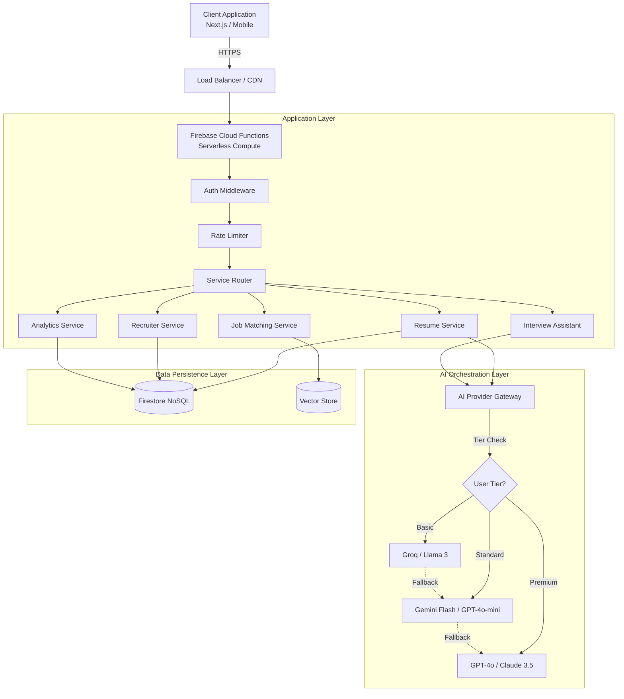

# System Architecture & Technical Design

This document provides a comprehensive overview of the SwitchCV architecture, database schema, and core design decisions.

## 1. High-Level Architecture

## 2. Document-Oriented Schema (Firestore)

### `users`
Stores user profile information and settings.
- `subscriptionTier`: "basic" | "premium" | "enterprise"
- `isRecruiter`: Role flag for access control.

### `resumes`
- `resumeId` (number): Numeric ID.
- `embedding` (array<number>): Vector embedding for AI semantic search.
- `profile`: Full resume content.

### `recruiterRequests`
Tracks contact requests from recruiters to candidates.
- `status`: "pending" | "approved" | "denied"

## 3. Design Decisions & Trade-offs

### Next.js 14 (Frontend)
- **SSR/RSC**: Chosen for SEO and performance (faster mobile loads).
- **Vercel**: Edge caching and seamless deployment.

### Firebase Cloud Functions (Backend)
- **Scale-to-Zero**: Cost optimization for variable traffic.
- **Maintenance-Free**: No infra management needed.

### AI Orchestration (Tiered Gateway)
- **Circuit Breaker**: Prevents system hangs on provider failure.
- **Strategy Pattern**: Easy model swapping (OpenAI vs Gemini vs Groq).

## 4. Operational Controls
Flags are managed in the `config/system` Firestore document, allowing instant toggles for:
- **Maintenance Mode**: Banner and blocking controls.
- **Auth**: Disabling registration/login during incidents.
- **Rate Limits**: Dynamic adjustment of AI and API thresholds.
